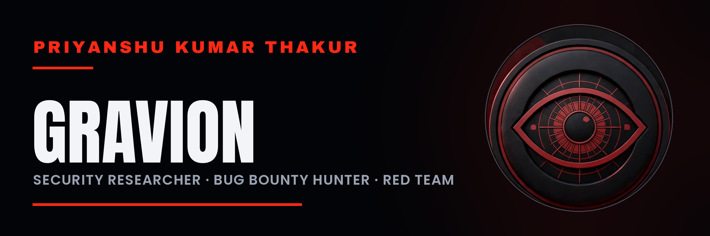

### PRIYANSHU KUMAR THAKUR

**Application Security & LLM Security Researcher**

Bug bounty hunter working web, API and WordPress flaws — IDOR, broken access control, business logic — and AI/LLM red teaming. Every finding is proved in the lab and reported responsibly, with proof.

🌐 [Portfolio](https://gravion-ux.github.io/portfolio/) · 📄 [Resume (PDF)](https://github.com/gravion-ux/gravion-ux/blob/main/resume.pdf) · 💼 [LinkedIn](https://www.linkedin.com/in/priyanshukumarthakur) · 🛠️ [Fiverr](https://www.fiverr.com/ig_priyanshu) · ⭐ [GitHub Sponsors](https://github.com/sponsors/gravion-ux)

> **Open to opportunities** — Penetration Tester / Application Security / Security Analyst roles (remote preferred, Delhi NCR) and freelance security-testing engagements: web, API, WordPress and AI-chatbot assessments. Reach me on [LinkedIn](https://www.linkedin.com/in/priyanshukumarthakur) or via [Fiverr](https://www.fiverr.com/ig_priyanshu).


---

## START HERE

**What I do** — application security and LLM security: penetration testing, vulnerability research, and the open-source tools that come out of that work.

**Strongest proof — all of it checkable:**
- An upstream fix merged into someone else's production codebase: the IPv6 rate-limit bucketing fix in [xerj-org/xerj#2872](https://github.com/xerj-org/xerj/pull/2872)
- 6 of 6 pull requests I have opened in other people's repositories merged — and two external contributors' PRs merged into my own tools
- Responsible disclosures, written up with scope, method, impact and remediation: [security-research](https://github.com/gravion-ux/security-research)

**Three doors in:**
- **Security tools** — the six flagships below: wp-cve-hunter, llm-redteam-kit, mcp-shield, jwt-auditor, gravion-ai, aegis
- **Research** — [security-research](https://github.com/gravion-ux/security-research): sanitised disclosure write-ups
- **Apps** — [TaskForge](https://github.com/gravion-ux/taskforge) (MERN team task manager) · [ChatSphere](https://github.com/gravion-ux/chatsphere) (real-time chat) · [ExpenseMate](https://github.com/gravion-ux/expensemate) (React Native expense tracker) — each built end-to-end: API, UI, tests, CI
---

### 01 / FROM THOUGHT TO THING

```
$ hunt()

scope → read → test → report
```

**THINK** — Read the code. Map the logic. Find where trust is assumed.
**EXECUTE** — Test it in the lab. Reproduce it, cleanly.
**BUILD** — Report it responsibly, with proof.

- Business-logic flaws
- IDOR & broken access control
- Auth bypass
- Payment & checkout flaws

### 02 / LIFE OUTSIDE THE COMMIT


1. **AI cinematic video tutorials** — voiceover-driven tutorials; every tool taught step by step.
2. **Building GRAVION AI** — a modular AI platform startups build on, made piece by piece.
3. **Building security tools** — open-source tools and a portfolio the community can actually use.

**BELIEF** — Proof, not promises: if it isn't reproduced and measured, it isn't claimed.

---


---

## 03 / MY ONLINE ROOM


**Languages**

    

**Frontend & Runtime**

   

**Backend, Cloud & AI**

   

---

## FLAGSHIP WORK

Six projects carry the portfolio. Each one exists because a real assessment kept hitting the same problem.

| Project | The problem it solves |
| --- | --- |
| [llm-redteam-kit](https://github.com/gravion-ux/llm-redteam-kit) | LLM regressions ship silently — this runs an OWASP LLM Top 10 probe pack as a CI gate, so a prompt or model change that reopens an injection hole fails the build instead of reaching users. |
| [mcp-shield](https://github.com/gravion-ux/mcp-shield) | Agent setups trust MCP servers blindly — this audits their configuration and tool definitions first, catching poisoned tool descriptions, hidden instructions and over-broad access before the server ever runs. |
| [jwt-auditor](https://github.com/gravion-ux/jwt-auditor) | The JWT flaws behind real account takeovers — `alg=none`, weak secrets, key-injection headers — checked fully offline, with a scored report a team can act on. |
| [wp-cve-hunter](https://github.com/gravion-ux/wp-cve-hunter) | WordPress owners can't tell which disclosed CVEs actually apply to their site — read-only fingerprinting matched against real vulnerability data, prioritised by CVSS. |
| [gravion-ai](https://github.com/gravion-ux/gravion-ai) | Small teams shipping AI products bolt licensing on last, or never — a modular platform (chat, code, image, music, video) with cryptographic licensing and tiering built into the core. |
| [aegis](https://github.com/gravion-ux/aegis) | Agentic testing drifts out of scope when limits live in prompts — a chief agent decomposes missions for specialist sub-agents and refuses out-of-scope work in code, with a tamper-evident audit log. |

**How the toolkit fits together** — the tools form one pipeline. **Hunt:** fingerprint and probe the target (wp-cve-hunter, jwt-auditor, llm-redteam-kit, mcp-shield). **Verify:** reproduce each finding under enforced scope, with an audit trail, before believing it (gravion-harness, aegis). **Report:** every tool emits scored, prioritised, remediation-ready output by default — the same discipline my bounty reports follow. gravion-ai applies that discipline to building AI products instead of breaking them.

---

## CASE STUDIES

Short version of four pieces of work — the problem, what I did, and the outcome that can be checked.

### 1. wp-cve-hunter — fingerprinting that tells owners which CVEs actually apply

**Problem.** WordPress site owners see hundreds of disclosed plugin CVEs and cannot tell which ones touch their install; generic scanners guess versions and cry wolf.
**What I built.** [wp-cve-hunter](https://github.com/gravion-ux/wp-cve-hunter) — read-only fingerprinting matched against real vulnerability data, prioritised by CVSS, so the output is a short list of what to patch first instead of a wall of noise.
**Outcome.** The project took its first external contribution: PR #5 from kanna857, adding a dataset entry for the UpdraftPlus CVE-2022-0633, reviewed and merged on 22 Nov 2026 — outside validation that the data format is usable by people other than its author.

### 2. llm-redteam-kit — an OWASP LLM Top 10 probe pack that runs as a CI gate

**Problem.** LLM apps regress silently: a prompt tweak or model swap reopens an injection hole and nobody notices until a user does.
**What I built.** [llm-redteam-kit](https://github.com/gravion-ux/llm-redteam-kit) — a curated probe pack with transparent scoring that runs in CI, so a change that reopens a hole fails the build. The suite is green locally (46 tests) and the pack stays in sync with the released version.
**Outcome.** A second external contributor, Ajay (AJaysAIk), extended the pack itself: PR #6 added probes pi-007 and pi-008, reviewed and merged on 22 Nov 2026.

### 3. GRAVION AI — a modular AI platform with licensing in the core, shipped early

**Problem.** Small teams shipping AI products bolt licensing and tiering on last, or never — and it shows up later as a rewrite.
**What I built.** [gravion-ai](https://github.com/gravion-ux/gravion-ai) — a modular platform (chat, code, image, music, video) with cryptographic licensing and tiering built into the core rather than layered over it.
**Outcome.** v0.11.0 shipped on 24 Nov 2026, a day ahead of its 25 Nov deadline, with the full suite green: 385 tests, 380 passing, 5 skipped, 0 failing.

### 4. Upstream fix — IPv6 rate-limit bucketing in xerj

**Problem.** The Corpus Hub rate limiter in [xerj-org/xerj](https://github.com/xerj-org/xerj) keyed limits per compressed IPv6 address, so an attacker holding a standard /64 allocation could rotate through effectively unlimited buckets.
**What I did.** Fixed the limiter to bucket compressed IPv6 addresses by their /64 prefix, with the change kept small enough to review in one sitting.
**Outcome.** Merged upstream as [xerj-org/xerj#2872](https://github.com/xerj-org/xerj/pull/2872) on 17 Nov 2026 — my fix, in someone else's production codebase, under their review process.
---

## REAL WORK. REAL IMPACT.

| 46 | 4,010 | 03 |
| --- | --- | --- |
| **OPEN-SOURCE PROJECTS** — 45 of 46 MIT licensed | **MEASURED TESTS** — across 44 repositories | **PLATFORMS** — Patchstack + HackerOne + Bugcrowd |
- **Upstream contributor** — merged PRs into [xerj-org/xerj](https://github.com/xerj-org/xerj), open-source security tooling.
- **Bug bounty researcher** — WordPress ecosystem; every finding lab-verified and deduped before it is reported.

**CORE CRAFT**

```
WordPress plugin audit      ████████████████████
IDOR & access control       ████████████████████
Business-logic flaws        ████████████████████
Responsible reporting       ████████████████████
```

*Bars mark focus areas, not scores.*

---

## GITHUB AT A GLANCE


---

## 04 / SUPPORT THE BUILD

46 open-source projects — 45 of them MIT licensed, 44 with their own measured test suite. If one saved you time in your own lab, a contribution keeps the suites green and the releases coming. Sponsors also keep the work independent: see the [support page on my portfolio](https://gravion-ux.github.io/portfolio/support.html) for other ways to contribute.
Monthly tiers from $5, one-time tiers from $25 — the full tier list lives on the [Sponsors page](https://github.com/sponsors/gravion-ux).

⭐ [Sponsor the build on GitHub](https://github.com/sponsors/gravion-ux)

### Supporters

Contributions are credited here by name. The list is empty until the first sponsorship lands, and it grows from there.

Name placement starts at the $5 a month Supporter tier or the $25 one-time Backer tier for the Supporters section of this README, and at the $25 a month Sponsor tier or the $50 one-time Sponsor tier for the sponsor sections of the flagship repository READMEs.

---

## LET'S CONNECT.

### BUILD SOMETHING GREAT.

|  |  |
| --- | --- |
| 🌐 Website | [gravion-ux.github.io/portfolio](https://gravion-ux.github.io/portfolio/) |
| ✉️ Email | priyanshukumarthakur937@gmail.com |
| 💼 LinkedIn | [priyanshukumarthakur](https://www.linkedin.com/in/priyanshukumarthakur) |
| 💻 GitHub | [@gravion-ux](https://github.com/gravion-ux) |

*Proof, not promises.*
