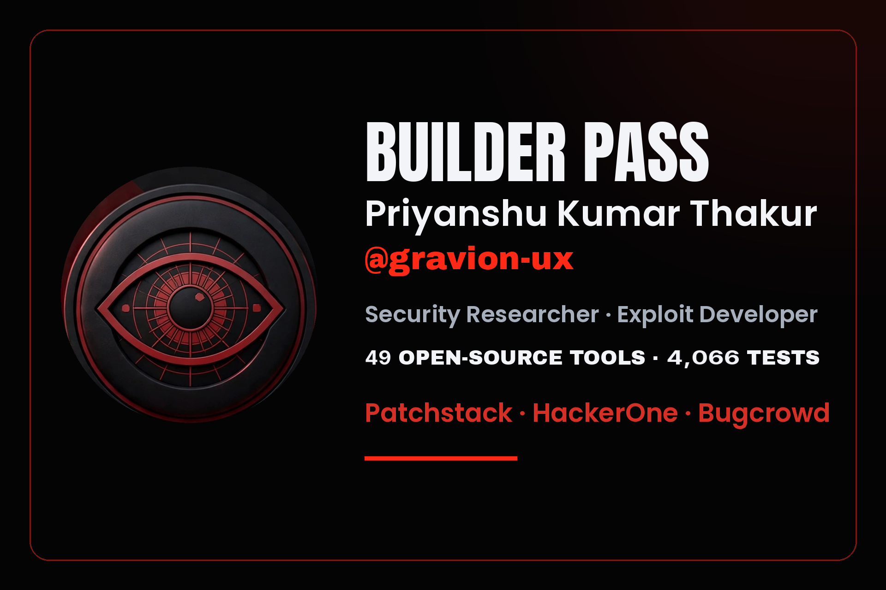
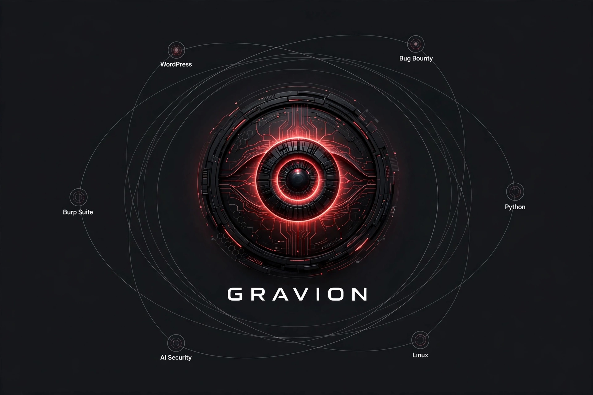

### PRIYANSHU KUMAR THAKUR

**Security Researcher · Exploit Developer · Red Teamer · AI/LLM Security**

I hunt vulnerabilities in web applications, APIs and WordPress — business logic, IDOR, broken auth, payment flaws — prove each one in the lab, and report it responsibly, with proof.

🌐 [Portfolio](https://gravion-ux.github.io/portfolio/) · 💼 [LinkedIn](https://www.linkedin.com/in/priyanshukumarthakur) · 🛠️ [Fiverr](https://www.fiverr.com/ig_priyanshu) · ⭐ [GitHub Sponsors](https://github.com/sponsors/gravion-ux)



---

### 01 / FROM THOUGHT TO THING

```
$ hunt()

scope → read → test → report
```

**THINK** — Read the code. Map the logic. Find where trust is assumed.
**EXECUTE** — Test it in the lab. Reproduce it, cleanly.
**BUILD** — Report it responsibly, with proof.

- Business-logic flaws
- IDOR & broken access control
- Auth bypass
- Payment & checkout flaws

### 02 / LIFE OUTSIDE THE COMMIT


1. **AI cinematic video tutorials** — voiceover-driven tutorials; every tool taught step by step.
2. **Building GRAVION AI** — a modular AI platform startups build on, made piece by piece.
3. **Building security tools** — open-source tools and a portfolio the community can actually use.

**BELIEF** — Proof, not promises: if it isn't reproduced and measured, it isn't claimed.

---


---

## 03 / MY ONLINE ROOM



**Languages**

    

**Frontend & Runtime**

   

**Backend, Cloud & AI**

   

---

## THINGS I'VE BUILT

| Project | What it does | Focus |
| --- | --- | --- |
| [wp-cve-hunter](https://github.com/gravion-ux/wp-cve-hunter) | WordPress CVE fingerprinting — prioritised Markdown/JSON reports | Python · WordPress security |
| [llm-redteam-kit](https://github.com/gravion-ux/llm-redteam-kit) | OWASP LLM Top 10 regression harness with a CI gate | AI / LLM security |
| [gravion-ai](https://github.com/gravion-ux/gravion-ai) | Modular AI platform with cryptographic licensing | AI platform |

---

## REAL WORK. REAL IMPACT.

| 38 | 3,364 | 03 |
| --- | --- | --- |
| **OPEN-SOURCE TOOLS** — 38 of 38 MIT licensed | **MEASURED TESTS** — across all 38 repos | **PLATFORMS** — Patchstack + HackerOne + Bugcrowd |

- **Upstream contributor** — merged PRs into [xerj-org/xerj](https://github.com/xerj-org/xerj), open-source security tooling.
- **Bug bounty researcher** — WordPress ecosystem; every finding lab-verified and deduped before it is reported.

**CORE CRAFT**

```
WordPress plugin audit      ████████████████████
IDOR & access control       ████████████████████
Business-logic flaws        ████████████████████
Responsible reporting       ████████████████████
```

*Bars mark focus areas, not scores.*

---

## GITHUB AT A GLANCE


---

## 04 / SUPPORT THE BUILD

Everything here is MIT licensed — 38 of 38 tools, each with its own measured test suite. If one saved you time in your own lab, a contribution keeps the suites green and the releases coming.

**Monthly** — Supporter $5 · Backer $10 · Sponsor $25 · Pro Sponsor $50 · Security Partner $100 · Anchor $500 · Executive $1,000

**One-time** — One-time Backer $25 · One-time Sponsor $50 · Fix a bug $50 · Fund a feature $250 · Fund a release $1,000 · Fund a roadmap quarter $2,500

Monthly tiers from $5, one-time tiers from $25. Custom amounts start at $5, with $25 recommended.

⭐ [Sponsor the build on GitHub](https://github.com/sponsors/gravion-ux)

### Supporters

Contributions are credited here by name. The list is empty until the first sponsorship lands, and it grows from there.

---

## LET'S CONNECT.

### BUILD SOMETHING GREAT.

|  |  |
| --- | --- |
| 🌐 Website | [gravion-ux.github.io/portfolio](https://gravion-ux.github.io/portfolio/) |
| ✉️ Email | priyanshukumarthakur937@gmail.com |
| 💼 LinkedIn | [priyanshukumarthakur](https://www.linkedin.com/in/priyanshukumarthakur) |
| 💻 GitHub | [@gravion-ux](https://github.com/gravion-ux) |

---

*Proof, not promises.*
